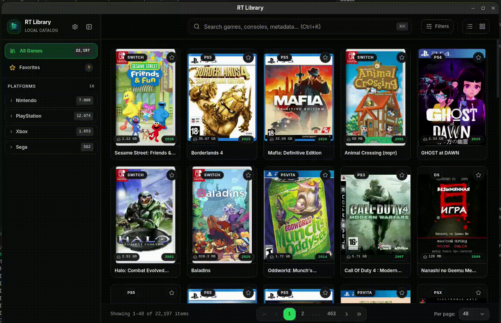
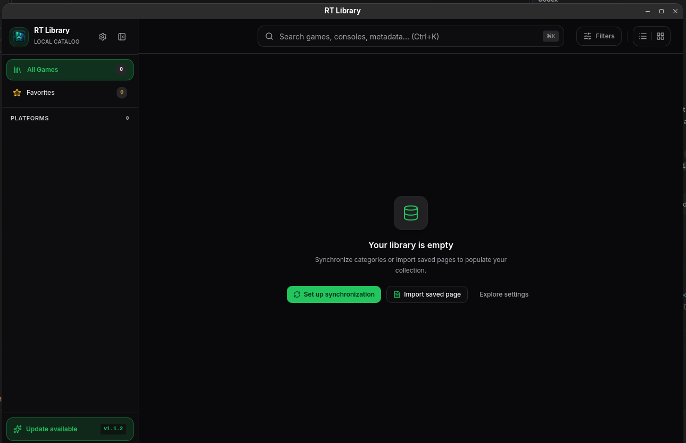
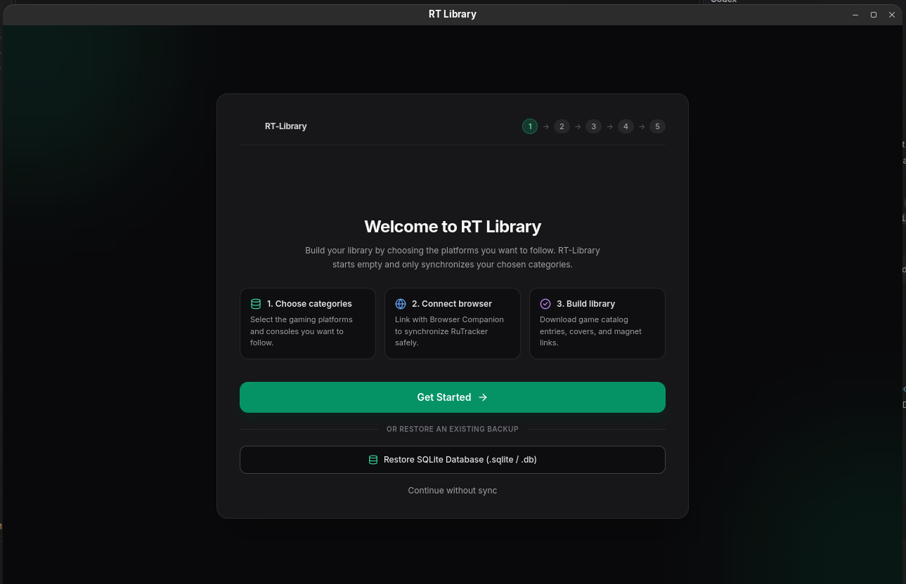
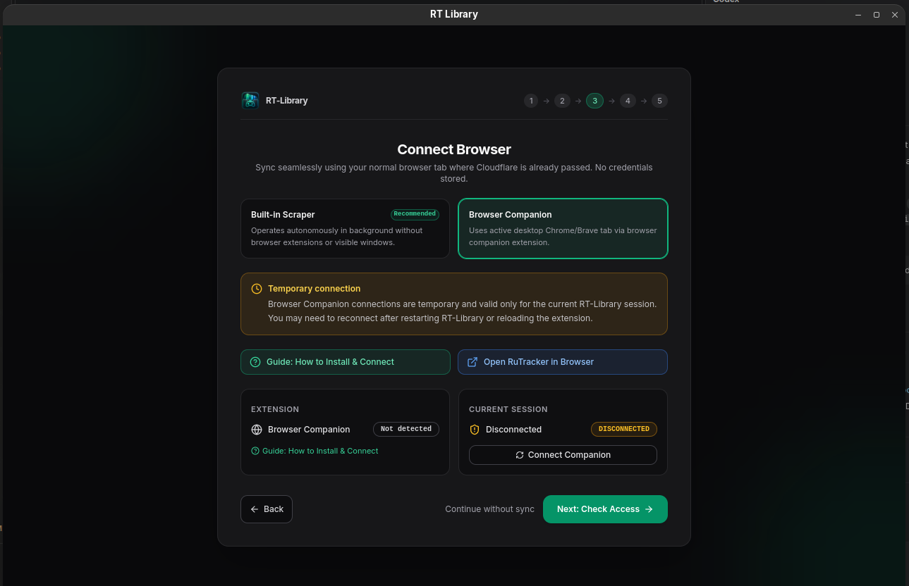
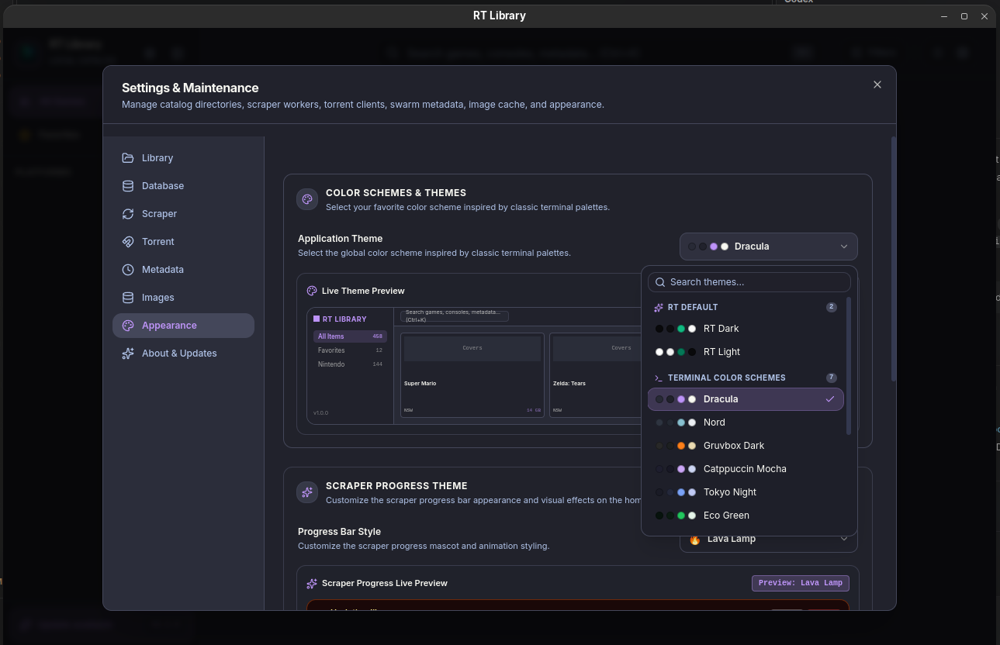
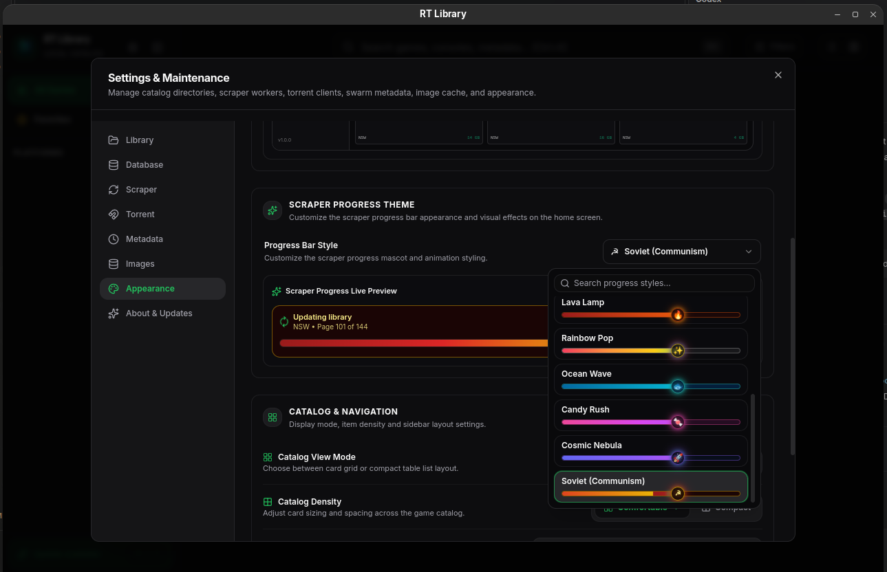

# RT-Library

> Local-first desktop catalog manager for game metadata and personal library organization.

<p align="left">
  
  
  
  
  
  
</p>

RT-Library is a local-first desktop application for organizing game metadata catalogs. It uses Electron, React, TypeScript, and an embedded SQLite database, and supports user-initiated metadata scraping.

The project packages the application for Linux and Windows. It starts with an empty catalog; users manage their own metadata and local library data.

When online sync is unavailable, Scraper settings can import a RuTracker category or topic page saved as HTML. See [Manual HTML Import](docs/scraper.md#manual-html-import).

## Demo



## Screenshots

| Library | First-run setup |
|---|---|
|  |  |

| Browser Companion setup | Theme settings |
|---|---|
|  |  |

| Progress theme settings |
|---|
|  |

## Highlights

- **Local-first:** Catalogs, settings, and caches are stored on the user's device.
- **Large catalogs:** Designed for browsing and searching large collections.
- **Search and filters:** Find items by title and catalog metadata.
- **Item details:** View metadata, screenshots, file lists, and swarm information.
- **Metadata synchronization:** Synchronize game catalogs via Browser Companion (through your normal browser session) or direct Playwright scraper.
- **Manual HTML Import:** Import saved RuTracker pages offline without network requests.
- **Database tools:** Manage backups, check integrity, and rebuild indexes.
- **Customizable UI:** Choose from themes and English, Brazilian Portuguese, or Russian.
- **No bundled catalog:** The application ships without pre-populated catalog data.

For comprehensive technical documentation, Browser Companion installation, and sync workflows, see [docs/scraper.md](docs/scraper.md).
For extension technical details, see [browser-companion/README.md](browser-companion/README.md).
For known operational behaviors and limitations, see [docs/known-limitations.md](docs/known-limitations.md).

## Quick Start

Requirements: Node.js 18+ and npm 9+.

Development:
```bash
npm install
npm run desktop
```

Build:
```bash
npm run build
```

Package for Linux or Windows:
```bash
npm run package:linux
npm run package:win
```

See the [installation guide](docs/installation.md) and [building and packaging guide](docs/building.md) for details.

## Releases

Official release artifacts are generated by GitHub Actions from version tags:

- Linux: AppImage (`RT-Library-${version}-linux-${arch}.AppImage`)
- Windows: Portable executable (`RT-Library-${version}-windows-x64-portable.exe`)
- Browser Companion: Extension zip (`rt-library-browser-companion-v${version}.zip`)
- Integrity: `SHA256SUMS.txt`

See the [release and versioning guide](docs/releasing.md).

## Privacy & Safety

The repository and installers do not include pre-scraped catalogs or media. Catalogs, downloaded previews, settings, and scraper sessions are kept locally. Network requests are made by user-initiated features; the app does not send analytics or catalog contents to RT-Library servers and does not bypass CAPTCHA, Cloudflare, or WAF checks.

See [data storage](docs/data-storage.md), [security policy](SECURITY.md), [scraper documentation](docs/scraper.md), [image pipeline](docs/image-pipeline.md), and [legal policy](LEGAL.md).

## Documentation

| Area | Documentation |
|---|---|
| Installation | [Installation Guide](docs/installation.md) |
| Building | [Building & Packaging](docs/building.md) |
| Releases | [Release & Versioning](docs/releasing.md) |
| Architecture | [System Architecture](docs/architecture.md) |
| Scraper | [Scraper Architecture](docs/scraper.md) · [Browser Companion](docs/browser-companion.md) |
| Database | [Database Management](docs/database-management.md) |
| Images | [Image Pipeline & Caching](docs/image-pipeline.md) |
| Storage | [Data Storage](docs/data-storage.md) |
| Testing | [Testing & Regression](docs/testing.md) |
| Performance | [Performance & Benchmark](docs/performance-benchmark.md) |
| UI | [UI Current State](docs/ui-current-state.md) |
| Legal | [Legal Policy](LEGAL.md) |
| Security | [Security Policy](SECURITY.md) |
| Contributing | [Contributing Guidelines](CONTRIBUTING.md) |
| Third-party licenses | [Notices](THIRD_PARTY_NOTICES.md) · [License inventory](THIRD_PARTY_LICENSES.txt) |

## Contributing

Contributions are welcome. See [CONTRIBUTING.md](CONTRIBUTING.md) for the development workflow and guidelines.

## AI-Assisted Development

AI-assisted tools supported architecture exploration, implementation, refactoring, testing, debugging, documentation, and UI work.

Generated suggestions were reviewed rather than assumed correct. Features and subsystems were tested and refined against the project requirements and runtime behavior.

## License

RT-Library is licensed under the [MIT License](LICENSE). Third-party acknowledgments and license details are in [THIRD_PARTY_NOTICES.md](THIRD_PARTY_NOTICES.md) and [THIRD_PARTY_LICENSES.txt](THIRD_PARTY_LICENSES.txt).
