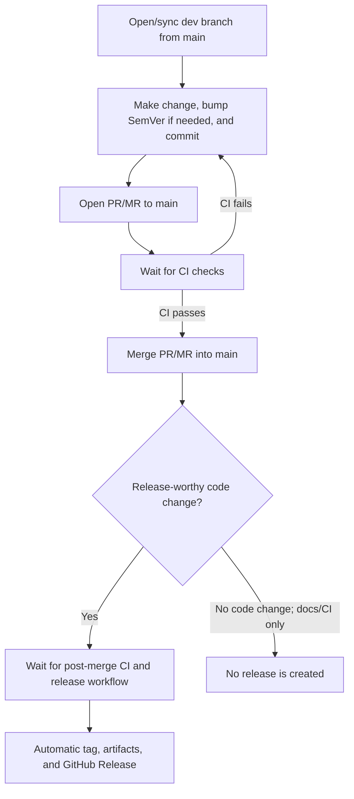
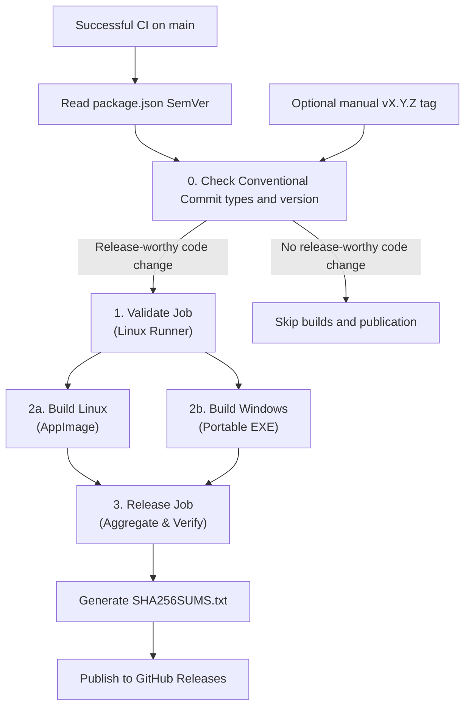

# Release & Versioning Guide

This document outlines the official versioning policy, release preparation process, and automated cross-platform release pipeline for **RT-Library**.

---

## 1. Semantic Versioning Policy

RT-Library adheres strictly to [Semantic Versioning 2.0.0](https://semver.org/) (`MAJOR.MINOR.PATCH`):

- **MAJOR**: Incompatible architectural changes, major database schema rewrites requiring manual migration, or breaking IPC contract modifications.
- **MINOR**: New user-facing features, additional platform support, new themes, or new subforum category extractors added in a backwards-compatible manner.
- **PATCH**: Backwards-compatible bug fixes, security patches, styling/accessibility tweaks, and performance optimizations.

Release tags follow the format:
```
vMAJOR.MINOR.PATCH
```
Example: `v1.0.0`, `v1.1.0`, `v1.0.1`.

### Release eligibility from Conventional Commits

Application releases are created for release-worthy code changes since the previous release:

- `feat` triggers a MINOR release.
- `fix`, `perf`, or `revert` triggers a PATCH release.
- A non-documentation breaking change marked with `!` or a `BREAKING CHANGE:` footer triggers a MAJOR release.
- A documentation-only change uses `docs:`. It does not bump the application version or create a release tag. `test`, `ci`, and maintenance-only commits do not trigger a release by themselves.

The release workflow checks commits since the previous release tag. A commit can trigger a release only when it uses a release-worthy Conventional Commit type and changes application code. Changes limited to `.github/`, documentation files, changelog/legal files, or generated output do not trigger a release. Documentation and CI-only work still goes through the normal Pull Request checks and merge flow.

---

## 2. Development and Release Preparation Workflow

Every code or documentation change follows the project workflow: start from `main`, work on the `dev` branch, commit with Conventional Commits, open a Pull Request to `main`, wait for GitHub Actions, and merge only after all required checks pass. If `dev` is absent, create it from the latest `main`. Keep `dev` synchronized with `main` after each merge. Release-worthy code changes need a SemVer version bump in the package metadata and a changelog entry. After the merge, a successful CI run on `main` automatically builds the release artifacts, creates the matching `vMAJOR.MINOR.PATCH` tag, and publishes a GitHub Release. Documentation-only commits do not create a release.



### Step 1: Prepare a code release on `dev`

Use this process only when the commits since the previous release include a release-worthy code change. For a documentation-only change, use a `docs:` commit and do not update the application version, create a release tag, or run the release preparation helper.

For a code release, start from an up-to-date `dev` branch. Choose the next version according to the SemVer policy above. Use the release preparation helper to update `package.json` and `package-lock.json` without creating a tag:
```bash
npm run release:prepare 1.1.0
```

Edit `CHANGELOG.md` with the release date and notes:
```markdown
## [1.1.0] - YYYY-MM-DD

### Added
- Feature description...

### Fixed
- Bug fix description...
```

### Step 2: Validate and commit

Run the local checks before opening the Pull Request:
```bash
npm test
npm run build
npm run audit:licenses
npm run release:check
npm run release:validate v1.1.0
```

Commit the version and changelog changes on `dev` using a Conventional Commit message:
```bash
git add package.json package-lock.json CHANGELOG.md
git commit -m "chore(release): v1.1.0"
git push -u origin dev
```

Open a Pull Request from `dev` to `main`. Wait for every required GitHub Actions check to pass; fix failures on `dev`, push the fix, and wait for the checks again. Merge only after all required checks pass.

### Step 3: Confirm the automatic release

After the Pull Request is merged, the successful `main` CI run automatically validates and publishes the release. It uses the version from `package.json`, checks that the version is newer than the previous release, builds Linux, Windows, and Browser Companion artifacts, and attaches them with checksums to the GitHub Release. No manual tag push is needed.

Confirm the published release and artifacts in GitHub Releases. To validate the version locally:
```bash
git switch main
git pull --ff-only origin main
npm run release:validate v1.1.0
```

The tag-triggered release workflow remains available for manually pushed release tags, but the normal release path is the successful post-merge CI run. Do not push release version changes directly to `main`.

---

## 3. Automated GitHub Actions Pipeline

`.github/workflows/ci.yml` starts on pull requests to `main` and pushes to `main`. It classifies changed paths, then runs tests, typecheck, and Windows native runtime validation on Ubuntu and Windows. Ubuntu builds the frontend, audits licenses, checks publication readiness, and builds the Companion only when Companion files changed or a release is eligible. Pull requests package Linux and Windows smoke binaries only when desktop packaging or updater files changed; these are validation artifacts retained for one day and are never release inputs.

After a successful `main` matrix, a release-worthy code change with a newer strict SemVer version stages the validated frontend and Companion outputs. The reusable `.github/workflows/release.yml` then builds the Linux AppImage and Windows portable executable for the exact commit, verifies the staged build inputs, packages the Companion, and publishes the assets. Automatic release validation reuses the successful CI tests and builds instead of repeating them. Manually pushed `v*.*.*` tags still run the full validation and build the frontend and Companion in that tag-triggered run.



### Pipeline Jobs & Guarantees:
0. **`detect-changes`**: Uses the shared path classifier to identify desktop, Companion, packaging, updater, and release-worthy changes. Documentation, CI, tests, and generated files do not independently trigger an application release.
1. **`test-matrix`**: Runs tests and typecheck on Ubuntu and Windows, the frontend build/license/readiness checks on Ubuntu, and the Windows native runtime smoke check on Windows. PR package smoke builds run only for packaging-sensitive changes. `npm ci` already invokes `electron-builder install-app-deps` through `postinstall`, so the duplicate explicit install step was removed.
2. **`prepare-release` / `release-eligibility`**: After the successful main matrix, reads the package version and scans commits since the previous release tag. Only `feat`, `fix`, `perf`, `revert`, or a non-documentation breaking change that changes application code, with a newer strict SemVer version, enables release jobs. CI-only and documentation-only changes skip publication.
3. **`validate` Gate**: Automatic releases reuse the successful main CI validation. A manual tag run performs the full test, frontend, license, readiness, and Companion checks and stages its own build inputs.
4. **`build-linux`**: Runs on `ubuntu-latest`, verifies the exact-SHA frontend artifact, packages the AppImage, and verifies runtime integrity and updater metadata.
5. **`build-windows`**: Runs on native `windows-latest`, verifies the exact-SHA frontend artifact, packages the portable executable, and validates updater metadata.
6. **`package-companion`**: Verifies the exact-SHA Companion build before creating its zip archive.
7. **`release`**: Runs on `ubuntu-latest` after platform packages and Companion succeed:
   - Downloads all compiled binary artifacts.
   - Strictly verifies the expected AppImage, portable executable, Companion zip, and update metadata.
   - Computes `SHA256SUMS.txt` and a `release-manifest.json` with source commit, version, workflow run, artifact IDs, platform, and SHA-256 for each asset.
   - Publishes the release assets and release notes directly to GitHub Releases.

### Artifact and cache policy

- PR package smoke artifacts are retained for one day. They are generated only for package-sensitive changes and cannot be consumed by release jobs.
- Main frontend and Companion inputs are uploaded only for release candidates, named by commit SHA, and retained for seven days. The release jobs require matching commit, version, workflow run ID and attempt, and file hashes before packaging.
- Published GitHub Release assets are the durable downloads and include checksums and the provenance manifest. Intermediate package artifacts are retained for five days.
- `setup-node` caches npm data from `package-lock.json`; Electron and electron-builder download caches are keyed by OS, Electron version, and lockfile with a same-OS/version restore prefix. `node_modules` is not cached.
- Electron packages still install on each native platform runner because their native modules must match that platform. Linux and Windows packaging therefore remain separate jobs; the release no longer repeats the cross-platform test suite or rebuilds the already validated frontend and Companion inputs.

---

## 4. Release Artifacts & Checksums

Each public release publishes:
1. **Linux AppImage**: `RT-Library-${VERSION}-linux-x86_64.AppImage`
2. **Windows Portable**: `RT-Library-${VERSION}-windows-x64-portable.exe`
3. **Integrity Checksums**: `SHA256SUMS.txt`

### Verifying Checksums
Users can verify the authenticity and integrity of downloaded binaries:
```bash
# On Linux
sha256sum -c SHA256SUMS.txt

# On Windows (PowerShell)
Get-FileHash -Algorithm SHA256 RT-Library-*-windows-x64-portable.exe
```

---

## 5. Security & Signing Notes

- **Least Privilege Permissions**: CI workflows run with `contents: read`. Only the final deployment step in `release.yml` uses scoped `contents: write`.
- **Fork Safety**: Pull requests from forks are executed in read-only mode without access to release tokens or repository write permissions.
- **Windows Code Signing**: Windows executables are currently built without an EV Code Signing certificate (`WINDOWS_CODE_SIGNING: NOT CONFIGURED`). Users may see a standard Windows SmartScreen prompt upon first launch.
